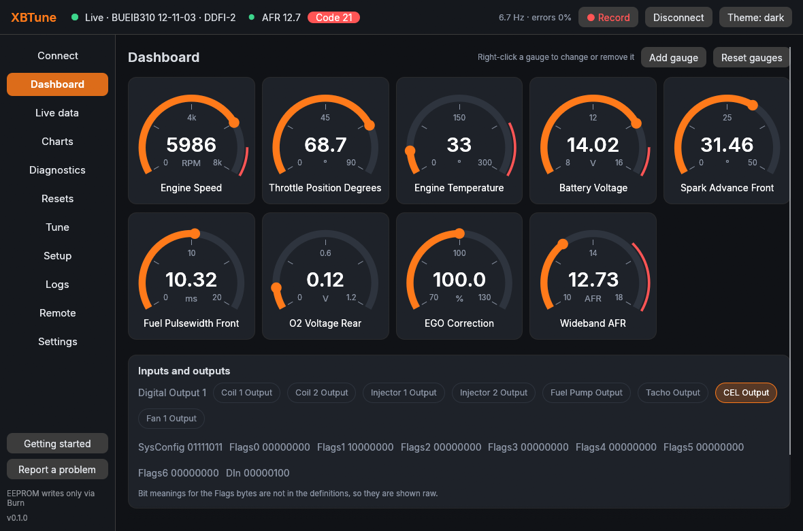
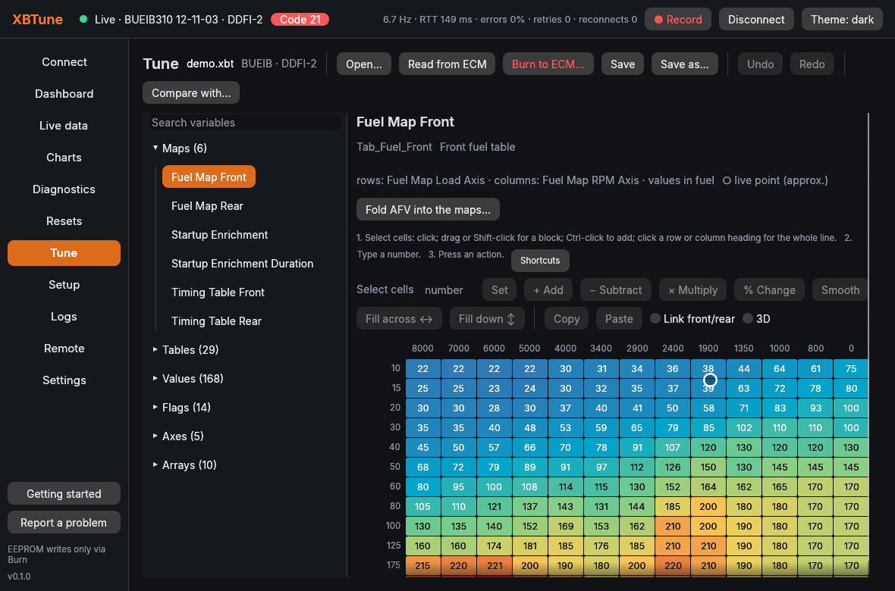
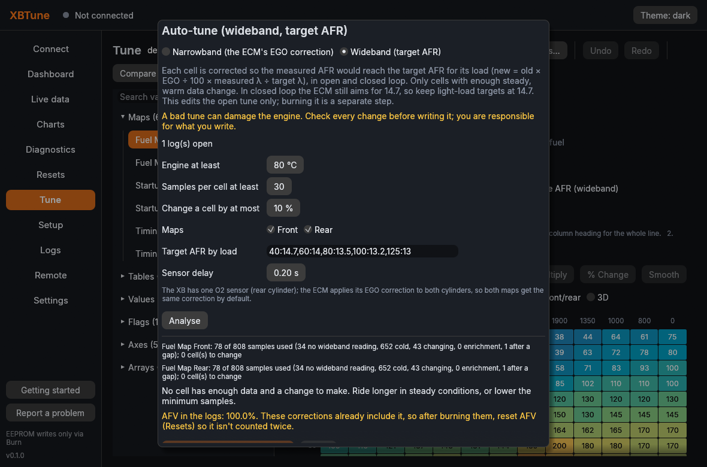
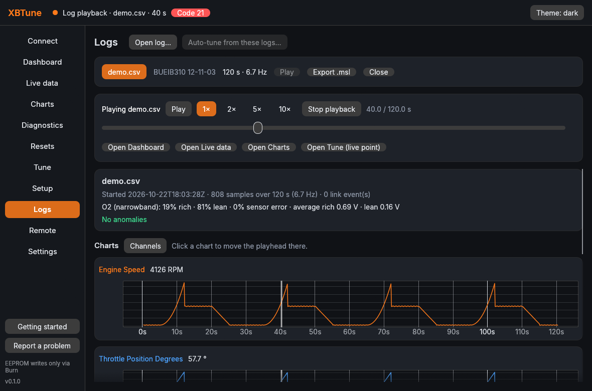
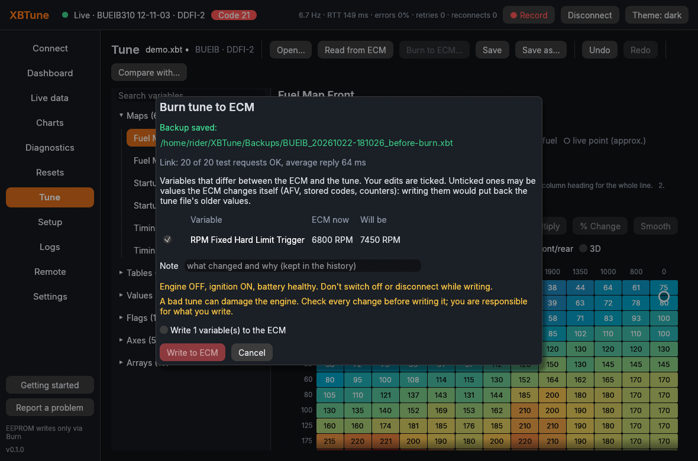
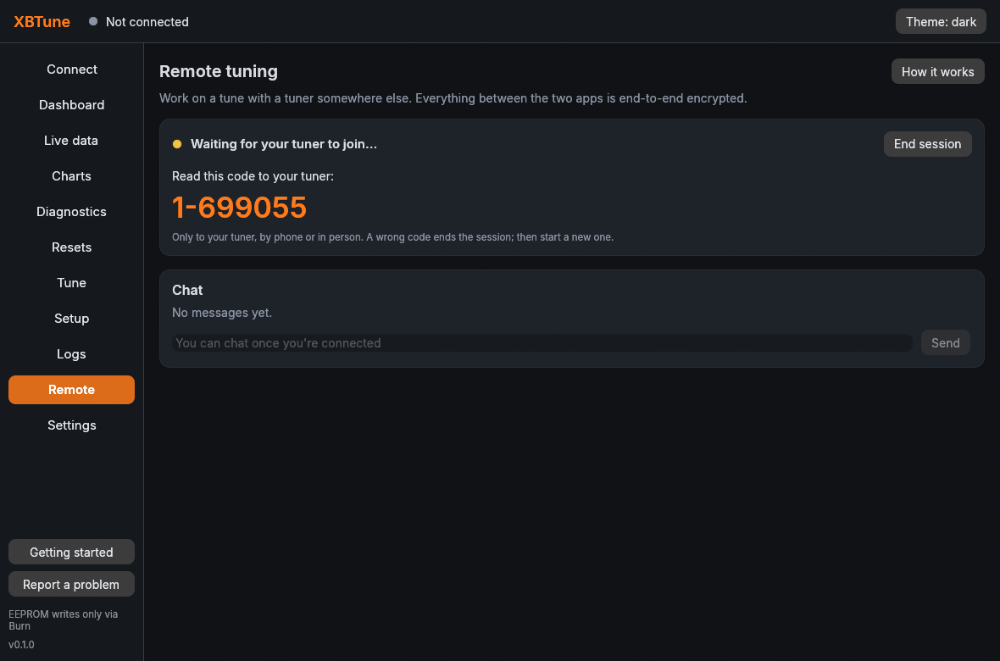

# XBTune

[](https://snapcraft.io/xbtune)

[](https://snapcraft.io/xbtune)
[](https://github.com/kz6fittycent/XBTune/actions/workflows/ci.yml)
[](LICENSE)

Diagnostics, logging and tuning for Buell DDFI ECMs, for Linux: the XB9
and XB12 (DDFI-2 and DDFI-3, 2003–2009), the tube-frame bikes (DDFI,
1999–2002) and factory race ECMs. Tested on a 2005 XB9SX; the others
only against the built-in simulator so far. Bluetooth (BuellTooth and other
SPP adapters) is the main link. USB serial cables work too.

XBTune is free: no price, no ads, no account. It identifies the ECM,
reads and saves the EEPROM, shows and logs live data (with an optional
Innovate LC-2 wideband), reads trouble codes and runs tests, edits tunes
offline, auto-tunes the fuel maps from logs (narrowband EGO, or toward a
target AFR with a wideband) and writes tunes to the ECM (backup, review,
write only what changed, read back). Remote tuning lets a tuner work on
your bike's tune over the internet, end-to-end encrypted; you choose what
the tuner may do in each session. Tests, resets and writes are each locked
on real hardware until you unlock them in Settings.



> **Warning: a bad tune can damage your engine.** Running lean or with
> too much spark advance can destroy pistons and valves in seconds under
> load. Auto-tune and remote edits are suggestions: check every change
> before you write it, change a little at a time, and keep your original
> backup. XBTune comes with **no warranty** (GPL-3.0); you are responsible
> for what you write to your ECM and how you ride.

## Install

XBTune is a snap for 64-bit Linux (amd64): Ubuntu, Debian, Fedora, Mint,
Manjaro and any other distribution with snapd.

```
sudo snap install xbtune --candidate     # while it's in testing
sudo snap install xbtune                 # once it reaches stable
```

Then allow it to use your adapters (snaps are confined, so this is needed
once):

```
sudo snap connect xbtune:bluez             # Bluetooth adapters (BuellTooth etc.)
sudo snap connect xbtune:raw-usb           # USB serial cables and the wideband cable
sudo snap connect xbtune:removable-media   # tunes and logs on USB sticks
```

Open **XBTune** from the app menu (or run `xbtune`); the command line is
`xbtune.cli`. The Getting started guide shows which connections are
missing, and `xbtune.cli doctor` checks them too. Your tunes, backups and
logs go in `~/XBTune`, which stays put through updates and even removal.

| Channel | What's there |
|---|---|
| `latest/candidate` | Each new version (0.1.1, 0.1.2, 0.2.0, ...); a testing issue is opened for it |
| `latest/stable` | Candidates promoted after testing |

**Full guide: the [wiki](https://github.com/kz6fittycent/XBTune/wiki)**
([installation](https://github.com/kz6fittycent/XBTune/wiki/Installation),
[adapters](https://github.com/kz6fittycent/XBTune/wiki/Adapters-and-Connecting),
[writing a tune](https://github.com/kz6fittycent/XBTune/wiki/Burning-a-Tune),
[troubleshooting](https://github.com/kz6fittycent/XBTune/wiki/Troubleshooting)).

## Screenshots

| | |
|---|---|
|  |  |
| Fuel map editor: heat map, live point, ops toolbar | Auto-tune from logs (narrowband or wideband) |
|  |  |
| Log viewer with playback | Writing a tune: backup, review, verify |
|  | |
| Remote tuning: code to read out to the tuner | |

More in the [wiki](https://github.com/kz6fittycent/XBTune/wiki).

## Supported ECMs

| Family | Bikes | ECM IDs | Tested |
|---|---|---|---|
| DDFI | Tube frame 1999–2002 | BUEGC, BUEIA, BUEJA, BUEKA | Simulator |
| DDFI-2 | XB 2003–2007 | BUECB, BUEGB, BUEIB, BUEIC | **BUEIB on a 2005 XB9SX**; others simulator |
| DDFI-3 | XB 2008+ | BUEOD, BUEWD, BUEYD, BUEZD, BUE1D, BUE2D, BUE3D | Simulator |
| Factory race | engraved race ECMs (0x55, 19200 baud) | | Simulator |

Have one of the untested ones? A read-only check (`info`, `dump`, `live`,
`codes`) and an [issue](https://github.com/kz6fittycent/XBTune/issues)
saying how it went helps a lot. Details: `docs/SUPPORTED_ECMS.md`.

## Command line

```
xbtune.cli doctor                       # snap connections and paths
xbtune.cli scan                         # Bluetooth adapters
xbtune.cli ports                        # USB serial adapters
xbtune.cli info --bt 00:11:22:AA:BB:CC  # identify the ECM over Bluetooth
xbtune.cli info --serial /dev/ttyUSB0   # ... or USB
xbtune.cli info --sim                   # against the built-in simulator
xbtune.cli info --serial /dev/ttyUSB0 --race   # a factory race ECM (0x55, 19200)
xbtune.cli dump --bt ADDR -o tune.xbt   # read and save the EEPROM (verified)
xbtune.cli show tune.xbt Tab_Fuel_Front # decode an image
xbtune.cli live --bt ADDR               # live data in the terminal
xbtune.cli log --bt ADDR -o ride.csv    # log live data to CSV
xbtune.cli codes --bt ADDR              # current and stored trouble codes
xbtune.cli set tune.xbt KRPM_Hard_Hi=7450 -o new.xbt   # offline edit
xbtune.cli burn --bt ADDR new.xbt --vars KRPM_Hard_Hi   # write (locked until unlocked)
xbtune.cli logstats ride.csv            # log summary, O2 statistics, anomalies
xbtune.cli autotune --tune tune.xbt ride.csv -o tuned.xbt   # EGO auto-tune (file only)
xbtune.cli log --bt ADDR --wideband /dev/ttyUSB1 -o ride.csv  # log with an Innovate LC-2
xbtune.cli autotune --tune tune.xbt ride.csv --wideband -o tuned.xbt   # toward a target AFR
xbtune.cli fold-afv tune.xbt -o folded.xbt   # fold the learned AFV into the fuel maps
xbtune.cli log-convert ride.csv -o ride.msl  # MegaLogViewer; reads EcmDroid .bin/.msl too
xbtune                                  # the desktop app
```

## Wideband

An Innovate LC-2 (or another Innovate MTS device) connects with its own USB
serial cable on the controller's serial OUT, separate from the ECM adapter.
Pick its port under **Connect → Wideband O2**, or pass `--wideband PORT` to
`live` and `log`. XBTune only listens to the controller. This was built from
Innovate's published protocol and tested against a simulated LC-2. It hasn't
been tried with a real controller yet, so please report how it goes.

## Getting started and reports

The app opens with a short **Getting started** guide (tick "Don't show this at
startup" to turn it off; it stays in the side bar). **Report a problem** in the
side bar sends a report with the app's recent log to the developer as a GitHub
issue, without needing a GitHub account. If the app crashes, it offers to send a
report the next time it starts. Nothing is sent unless you click Send. The relay
is in `relay/bug-report/`.

## Building from source

```
git clone https://github.com/kz6fittycent/XBTune.git && cd XBTune
sudo apt install pkg-config libdbus-1-dev libudev-dev libfreetype-dev libfontconfig-dev
cargo run -p xbtune-app             # the app
cargo run -p xbtune-cli -- --help   # the command line
cargo test --workspace
snapcraft pack                      # the snap
```

Bugs and ideas: [issues](https://github.com/kz6fittycent/XBTune/issues), or
**Report a problem** in the app.

## Credits and license

The protocol code is a Rust port of [EcmDroid](https://github.com/ecmdroid/ecmdroid)
by Michel Marti (GPL-3.0). The ECM definitions come from EcmDroid's
database (originally from ECMSpy), used with permission. See
`docs/PROVENANCE.md`.

XBTune is licensed GPL-3.0-or-later. See `LICENSE`.
